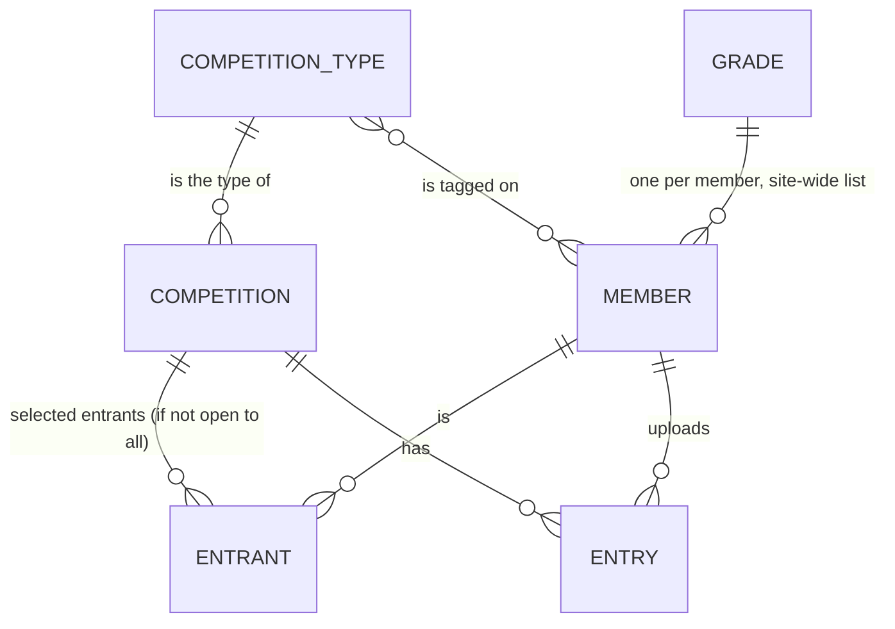

# Competition types design

Status: draft for approval · 2026-11-13

## Summary

This is how one website will run different kinds of competition side by side, for example a club's monthly competition, individual competitions and an interclub competition. Nothing is built yet.

How it will work:

- You set up **competition types**, such as "Individual" or "Interclub". Each type has its own list of categories (for example Colour and Mono, or Nature, Street, Insects and Portraits) and its own default settings, such as whether members or judges score it and the range of scores.
- When you create a competition, you choose its type. It starts with that type's categories and settings, and you can still change them for that one competition.
- There's still **one member list**. You tag each member with the types they take part in, and a member can have several tags. A club entering an interclub competition is a member too, tagged with the interclub type. You can filter the member list by type.
- Grades don't change. There's one list of grades for the whole website, and each member has one grade. A type can give the grades its own names, though. An interclub type could show Advanced as "Cup" and Non-advanced as "Shield", while individual competitions keep "Advanced" and "Non-advanced".
- A competition's title can include the grade name, for example "{grade} 2026". A club in the Cup then sees "Cup 2026" on its upload page and in its emails, and a club in the Shield sees "Shield 2026", even though both are one competition judged in one session.
- Each competition is either **open to everyone** with that type's tag, or **open to selected entrants only**. For a paid competition, you add each entrant when their payment arrives, creating the member first if they're new. Only entrants get upload links and can upload. Payment itself happens outside the website.
- A website that already uses the plugin gets one type, which every member and every competition belongs to, so nothing changes until you add a second type.

Not included:

- Interclub rules: adding up each club's scores for an overall winner, recording the photographer of each image a club enters, limiting images per photographer, and substitute images. These are a separate piece of work.
- Taking payments.

## Intent

The plugin runs one kind of competition per site. All competitions share one set of categories and settings, and every active member may enter every competition. Associations of clubs, and clubs that run more than one series, need several kinds of competition on one site:

- an interclub competition where the entrants are clubs, with two categories;
- individual competitions with differing subject categories (a nature competition with one category, another with four);
- paid entry, so only members who've paid may enter a given competition.

Running a separate site per kind of competition isn't an option for these clubs. They're not technical and host a single WordPress site themselves.

A related design, external judging (`2026-11-13-external-judging-design.md`), adds "who scores it" as a competition setting. Competition types supply its default. External judging doesn't depend on types.

## Model

## Goals

1. **Competition types.** An admin can create, rename and edit types. A type has:
   - a name;
   - a list of categories with quotas, edited the way the club's category list is edited today;
   - default settings for new competitions of the type. My call: these are every setting a competition can override today (voting, including who scores it and the score range; upload limits; slideshow; email reminders).
2. **Each competition belongs to exactly one type**, chosen when it's created. A new competition copies its type's categories and settings, as it copies the club's today. It can still change its own copy, and that copy then replaces the type's for that competition, matching the current **Category** rule in `CONTEXT.md`.
3. **One member list with type tags.** Each member has zero or more type tags. A member can hold several. The Members screen filters by type and lets the admin set tags on a member. CSV import accepts tags. My call: an unknown tag in an import is an error for that row, as an unknown grade is.
4. **Grades are unchanged underneath.** There's one site-wide list, and every member holds exactly one grade from it. Clubs entering an interclub competition hold a grade like anyone else.
   - **Per-type grade display names (decided).** A type can give any site-wide grade its own display name, for example Advanced as "Cup" and Non-advanced as "Shield". A grade without one shows its site-wide name. Everything a member or the public sees for a competition of that type uses the type's names: the upload page, emails, the voting page, the slideshow, results pages, the Top 3 shortcode and exports. Admin screens show both where it helps, for example "Cup (Advanced)". Recorded results keep the grade slug, so renaming a display name later relabels old results, as renaming a grade does today.
   - **Grade in the competition title (my call).** Clubs see "Cup 2026" and "Shield 2026" as titles, but one competition with two grades is judged in one session, so it stays one competition. Its title may contain a `{grade}` placeholder, such as `{grade} 2026`. Where one entrant is the audience (their upload page and their emails), it's filled with that entrant's grade display name. Where everyone is (the voting page, slideshow, results page, admin lists), it's filled with all the competition's grade names joined, for example "Cup / Shield 2026", and results are already split into a section per grade. A title without `{grade}` behaves as titles do today.
5. **Who may enter a competition.** Each competition has an entry setting:
   - **Open to all**: every active member tagged with the competition's type.
   - **Selected entrants only**: an explicit list of members, which the admin maintains on the competition. The picker lists active members with the competition's type tag first. An admin can create a new member from the competition and add them as an entrant in one step.
6. **Entrants can be added** at any time until voting has started in any category. An entrant added while uploads are open gets their upload link straight away. My call: it's sent automatically, as a requested email, and the admin can also resend it.
7. **Only entrants get upload links** and upload reminders, and only entrants can upload. An upload link held by someone who isn't (or is no longer) an entrant is refused. Requesting an upload link from the upload page only works for entrants.
8. **Payment isn't handled.** Adding someone as an entrant is how the admin records that they paid.
9. **Upgrade.** Existing sites get one type named "Individual" (decided). New installs get the same type. It takes the club's current categories and settings. Every member is tagged with it, and every competition, archived ones included, is set to it and open to all. Behaviour is identical until a second type is added.

## Non-goals

- Interclub rules: club totals and overall winners, recording an image's author, the two-images-per-author-per-panel limit, and substitute images. These are a separate piece of work.
- Payment of any kind.
- Grade lists per type, or a member holding a different grade in different types.
- Grouping public results pages by type. Results pages stay per competition.
- Changing a type's defaults retroactively. Existing competitions keep their own copy.

## Anti-goals

- A site with one type has to deal with types it doesn't use. With one type, the type picker and filters stay out of the way: the picker defaults to the only type, and the filters are hidden.
- A member who isn't an entrant in a paid competition can upload to it, or is emailed an upload link for it.
- Upgrading changes who can enter an existing competition, or changes its categories or settings.

## Decisions

Decided with the product owner:

- There's one member list. Entries keep linking to the member's ID.
- Members are tagged with the types they take part in, for filtering and for "open to all".
- Grades stay as one site-wide list, for example Advanced and Non-advanced across every type.
- Types differ mainly in their categories, which are typically subjects such as nature, street, insects, people and portraits.
- A competition is open to all members of its type, or to selected entrants added by the admin, typically when they've paid.
- Interclub rules and payment are out of scope.
- **One open competition at a time stays.** The overlap check (`Competitions_Repository::find_overlapping()`), the single current competition behind the upload and voting pages (`find_current_active()`), and the rule that only one category on the site accepts votes at a time are all unchanged. Competitions of different types run one after another. A Cup and Shield pair that runs at the same time is **one** competition, with the Advanced and Non-advanced grades as its two divisions: each entrant (club) holds the grade for its division, and results are already ranked per category and grade.
- Judging the two grades of one category in separate sessions isn't supported. A category's ballot covers every entry in it, across grades. That's a possible later change, alongside the "show only" mode from the judging design.

My calls (the reviewer should check these):

- A competition's type can't change once it has entries.
- A type can't be deleted while any competition (including archived ones) uses it, or while it's the only type.
- Removing an entrant who has entries is blocked until their entries are removed, as entries are removed today. Removing an entrant revokes their upload link.
- Switching a competition between open to all and selected entrants is allowed until voting starts. Switching to selected entrants starts with an empty list, and members who have already uploaded are added as entrants automatically, so nobody's entries are orphaned.
- **Voting in a member-scored competition with selected entrants.** Only entrants can get a voting link. The club voting password (honour system) still works for anyone, as it does today. A competition open to all lets any active member of its type get a voting link.
- **Member emails** follow entry. Upload links and reminders go only to entrants (or, for open to all, to members of the type). The results emails go to entrants who entered something, as today. The voting opened notification goes to members of the type.
- **Deactivating or deleting a member** works as today. A deactivated entrant stays on the entrant list but gets no links.
- **Tags on new members.** While the site has only one type, every new member gets that type's tag automatically, however they're added: from the Members screen, by CSV import or from a competition. Once there are several types, the add-member form asks for tags, and a CSV import without a tags column leaves members untagged. The Members screen flags untagged active members, because they get no links for open-to-all competitions. There's no "default type" concept.
- The existing club settings screen becomes the settings of the type created on upgrade. Club-wide settings that aren't competition defaults stay on Settings: email configuration, the grade list, page URLs and log retention.

## The current code it builds on

- Club defaults are stored in the `photo_comp_default_settings` option and parsed by `Support\Competition_Settings` (`defaults()`, `global_settings()`, `club_categories()`). A competition's own settings are JSON in `photocomp_competitions.settings`, and a competition with no categories of its own uses the club's list.
- `photocomp_members` has a single `grade` column and an `active` flag. Upload tokens are per member and competition (`photocomp_upload_tokens`). Voting tokens are per member, competition and category.
- Email kinds and their recipients are defined in `Service\Email_Kinds`. The upload link and voting opened emails currently go to every active member.

## Left to the builder

- Schema: a types table (or option), member–type tags, a type on each competition, and an entrants table. How type defaults are stored, whether they replace `photo_comp_default_settings` or sit beside it.
- The migration, and the upgrade test from 0.3.0 (release checklist).
- Admin UI layout for the Types screen, the type picker on a new competition, and the entrant list on a competition.
- How the entry setting and entrant list show on the competition edit screen.

## Docs to update alongside

- `CONTEXT.md`: add **Competition type** and **Entrant**. Update **Category** (a new competition copies its type's list, not the club's), **Grade** (unchanged, but say it's site-wide across types), and the opening line.
- `clubcompete_prd.md`: add the feature.

## Testing

A happy path and a validation test for each piece, at least:

- A competition created from a type copies the type's categories and settings, and editing the type afterwards doesn't change it.
- For an open-to-all competition, only active members with the type tag get upload links and can upload.
- For a selected-entrants competition, only entrants get upload links and can upload. A non-entrant's link is refused. Adding an entrant while uploads are open sends their link.
- Entrants can't be added once voting has started.
- A type in use can't be deleted, and a competition with entries can't change type.
- After an upgrade, a site has one type, every member is tagged with it, and every competition is open to all, with unchanged categories and settings.
- CSV import with type tags, including an unknown tag.
- A golden-master snapshot for each new or changed admin template partial.
