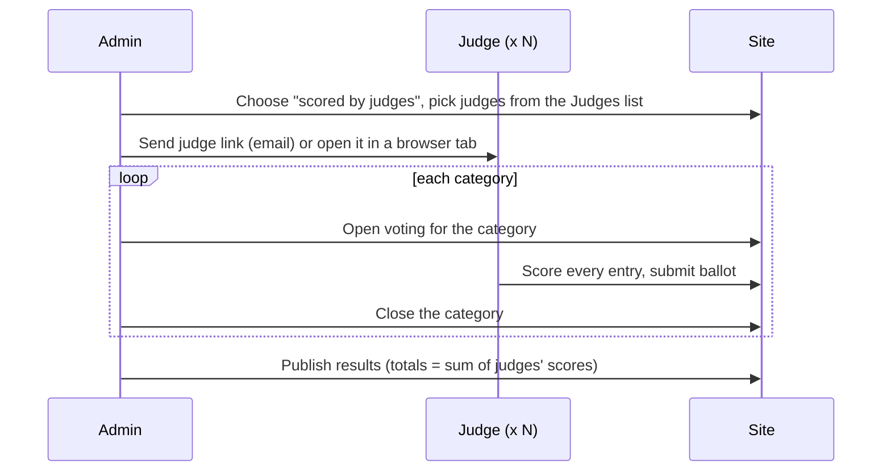

# External judging design

Status: draft for approval · 2026-11-13

## Intent

Most photography clubs don't let members vote. One or more external judges score every image, and the results are the sum of the judges' scores. Blarney's member voting is the unusual case. The request came from SACC (Southern Association of Camera Clubs, sacc.ie), whose interclub rules say: "Each judge will score independently. Results shall be based on the aggregate scores given by all judges to each competing panel." Other clubs need the same thing, so the feature isn't specific to SACC.

This is the first of two features SACC needs. The second, **competition types** (each type with its own members, grades, categories and default settings), will be designed separately afterwards. External judging must work on a site with a single type, as Blarney's site is today, and must not depend on types.

## How a judged competition runs

On the night, a judged competition runs just as a member-voted one does. Only the people holding voting links change.

- The admin runs the voting stages per category as now: preview, open voting, slideshow, close, next category. Only one category in the club accepts votes at a time.
- The judges score while a category is open, either live in front of an audience (IPF events, Blarney's Photographer of the Year) or the day before in a private session the club runs. Either way the admin decides which category is open. **Judges never score at their own pace over several days.**
- Each judge has their own voting link and uses it on a phone or computer. The link is emailed to the judge, or the admin opens it in a browser tab at the venue.
- Each judge gives every entry in the open category a score from the competition's existing score list, then submits. The submission is one ballot, as now.

## Goals

1. **Each competition says who scores it: members or judges.** Existing competitions, and new ones by default, stay member-scored, so Blarney sees no change.
2. **The site keeps a Judges list.** Each judge has a name and an email. Judges are reused across competitions, though any one judge is used rarely. Judges aren't members: they have no grade and no entries, they aren't on the Members screen, and they get none of the member emails (upload links, reminders, notifications, results).
3. **The admin picks one or more judges** from the list for each judged competition.
4. **Each picked judge gets a private link** to that competition. The admin can email it to the judge or copy it to open on the night. It accepts a ballot only for the category that is open for voting, and only while the competition is in the voting part of its life.
5. **A judge's ballot behaves like a member's ballot.** It is one score per entry in the category, from the competition's score list. One ballot per judge per category, kept whole or not at all.
6. **Members can't vote in a judged competition.** They get no voting links, the voting password doesn't work, and the voting page tells a member who arrives there that judges are scoring this competition.
7. **Judges see no entrant names.** The voting page already shows none, so this must stay true for judges. When competition types add club names and image authors, judges must not see those either.
8. **The results stay as they are.** An entry's total score is the sum of its votes, which here means the sum of the judges' scores. Positions are worked out per category and grade, and ties share a position (1, 1, 2). Results show **only the total** for each entry, with no per-judge breakdown anywhere public.

## Non-goals

- Awards: Highly Commended, Commended, best image, and so on. Positions only. SACC's "best individual image, as determined by the judges" is a judge's choice, not the top score, and is deferred too.
- Judge critique or comments.
- Judges scoring at their own pace over several days, outside the admin-run voting stages.
- Overall results per club, and anything else that belongs to competition types.
- A per-judge breakdown of scores in the public results.
- Mixing judges and member votes in one competition.

## Anti-goals

These would make the feature a failure even if it works:

- A judge sees who, or which club, took an image.
- Member-voted competitions change behaviour or get extra setup steps.
- A judge has to create a WordPress account or remember a password.
- Judges get member emails, or show up in member lists, member counts or member exports.

## The current code it builds on

- `Service\Voter` is the interface for whoever casts a ballot. It has two implementations: `Link_Voter` (a member, via a hashed token in `photocomp_voting_tokens`, one token per member, competition and category) and `Named_Voter` (a name plus the club password). `Service\Ballots::cast()` validates scores against `voting.score_matrix` and records them.
- `photocomp_votes` identifies a voter by `voting_token_id` or `voter_name`, with unique keys `(image_id, voting_token_id)` and `(image_id, voter_name)`.
- `voting.auth_mode` (`password` | `token`) is a setting on the club and on each competition. Per the PRD owner, the `token` (emailed link) path hasn't been tested properly. The judge link is a new path, but it should reuse what's sound in it.
- Results ranking and recorded results already sum the votes and rank per category and grade. They need no new rule.

## Decisions

Decided with the product owner:

- Scoring by judges is set per competition. Competition types will later supply the default.
- Several judges, each scoring independently. The total is the sum of their scores.
- The score range is the existing configurable score list. The IPF Shield example is three judges scoring 1–5, so 15 is the maximum.
- Judges are kept on file and reused.
- The admin controls which category is open, exactly as now.
- Ties share a position. Results show totals only.
- Awards are out of scope.

My calls (the reviewer should check these):

- **One judge link per judge per competition, not per category.** It works for whichever category is open, so the admin can hand a judge a single link for the night. Member links stay per category.
- **"Scored by" is locked once any vote exists** in the competition. Resetting a category and clearing its votes, across all categories, unlocks it. This stops a competition from mixing member and judge ballots.
- **Changing a competition's judges.** A judge can be added at any time. Removing a judge revokes their link. A ballot they already cast stays counted until that category is reset with its votes cleared, which matches how Reset already works.
- **Deleting a judge from the Judges list** removes their name and email, revokes their links, and keeps their votes without anything that identifies them. This mirrors deleting a member, so recorded and unrecorded totals don't move. The privacy eraser should cover judges by email.
- **The admin Voting screen shows which judges have submitted** for the open category, by name. That's the organiser's progress check on the night, and it shows no scores. Admins can still see raw votes wherever they can today.
- **The judge link email is a requested email**, a new kind with its own editable template on the Email Templates screen, sent from the competition screen per judge or to all its judges at once. It always sends, like other requested emails.
- **Vocabulary:** the UI says "score" and "judge" in judged competitions. The internal names (ballot, vote, voter) stay.

## Left to the builder

- Schema: a judges table, a competition–judge assignment, and how judge tokens and judge votes are stored. For example, a `judge_id` on votes and tokens, or a separate token table. The constraint is that votes must still be unique per image per voter, and a judge's ballot must be identifiable as theirs until the judge is deleted.
- The migration and how it runs on upgrade (see the release checklist: full upgrade test from 0.3.0).
- The admin UI layout for the Judges list and for picking judges on a competition.
- How the judge link is shown for copying (URL and/or QR code).
- Whether `Judge_Voter` is a third `Voter` implementation (the expected shape) or something else.

## Docs to update alongside

- `CONTEXT.md`: add **Judge** and **Judged competition**. Update **Voter**, **Ballot** and **Self-vote** (which doesn't apply to judges), and update the opening line, which says members vote.
- `clubcompete_prd.md`: add the feature.
- The member tutorial, if it mentions voting setup.

## Testing

Per AGENTS.md, a happy path and a validation test for each piece, at least:

- A judge casts a ballot in the open category, and the totals sum across judges.
- A judge link is rejected for a category that isn't open, after the judge is removed, and for another competition.
- A member link, or the voting password, is rejected in a judged competition.
- "Scored by" can't change once votes exist.
- Deleting a judge keeps the totals and removes the name and email.
- Judges never receive member emails, and member counts and exports exclude them.
- A golden-master snapshot for any new or changed admin template partial.
